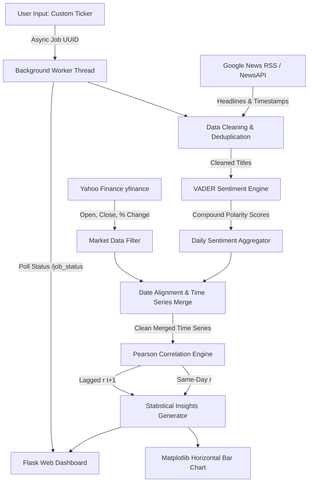

# 📈 Stock News Sentiment vs Price Movement Analyzer

[](https://www.python.org/)
[](https://flask.palletsprojects.com/)
[](https://github.com/cjhutto/vaderSentiment)
[](https://github.com/ranaroussi/yfinance)
[](LICENSE)
[](Procfile)

> **An end-to-end quantitative NLP pipeline and interactive dark-mode web application that extracts financial news headlines, scores sentiment polarity, synchronizes market price changes, and evaluates both same-day and lagged correlation across 30+ global and Indian equities.**

---

## 📑 Table of Contents

- [Overview](#-overview)
- [Key Features](#-key-features)
- [System Architecture & Data Pipeline](#-system-architecture--data-pipeline)
- [Empirical Research & Findings](#-empirical-research--findings)
- [Repository Structure](#-repository-structure)
- [Prerequisites & Installation](#-prerequisites--installation)
- [Usage & Running Locally](#-usage--running-locally)
- [Web API Endpoints](#-web-api-endpoints)
- [Deployment Guide](#-deployment-guide)
- [Tech Stack](#-tech-stack)
- [Future Enhancements](#-future-enhancements)
- [License](#-license)

---

## 🔍 Overview

Can financial news sentiment predict stock market price movement, or is news merely a lagging reaction to price volatility?

**Stock-News-Sentiment** explores this question through an empirical, data-driven approach:
1. Scraping rolling 30–90 day news headlines for companies across various market capitalizations (large-cap giants like Apple, Tesla, Reliance, and TCS, as well as emerging/mid-cap "underdogs" like Zomato, Paytm, Delhivery, and Happiest Minds).
2. Quantifying headline sentiment using **VADER** (`SentimentIntensityAnalyzer`) and mapping it onto a **0–10 Positivity Index**.
3. Aligning daily mean sentiment with actual trading sessions retrieved via **Yahoo Finance (`yfinance`)**.
4. Calculating both **Same-Day Pearson Correlation ($r_{t,t}$)** and **1-Day Lagged Correlation ($r_{t,t+1}$)** to determine whether positive news tends to move stocks on the same day or carry predictive signal into the next trading session.
5. Providing an interactive **Flask dashboard** with live asynchronous custom stock lookups, background polling, and automated plain-language insights.

---

## ✨ Key Features

- **🚀 Quota-Free News Ingestion**: Scrapes Google News RSS feeds with URI-encoded entity queries, bypassing third-party API rate limits and key constraints.
- **🧠 VADER NLP Sentiment Engine**: Evaluates headline compound polarity scores ($-1.0$ to $+1.0$) and scales them into an intuitive $0\text{–}10$ Positivity Index.
- **📊 Market Price Alignment**: Pulls daily Open, Close, and percentage price movement ($\% \Delta$) via `yfinance` and aligns dates across sentiment timestamps.
- **📐 Dual-Horizon Correlation**:
  - **Same-Day Correlation**: Measures synchronous relationship between headline tone and daily market closing movement.
  - **1-Day Lagged Correlation**: Evaluates whether day $t$ sentiment predicts day $t+1$ market performance.
- **⚡ Asynchronous Custom Stock Analysis**: Built-in non-blocking background worker (`threading` + UUID task tracking) allowing users to analyze any custom Yahoo Finance ticker without HTTP timeout on cloud hosting platforms.
- **💾 Client-Side Persistence**: Analyzed custom stocks automatically save to browser `localStorage` and render seamlessly across page refreshes.
- **🌙 Responsive Dark Mode UI**: Clean dark dashboard featuring horizontal correlation charts (`matplotlib`), dynamic badges, and automated natural-language narrative summaries.
- **☁️ Cloud-Ready Production Server**: Packaged with `gunicorn` and `Procfile` configured for seamless deployment on Render, Railway, or Heroku.

---

## 🏗 System Architecture & Data Pipeline



### Pipeline Steps:
1. **Fetch News (`fetch_news.py` / `pipeline.py`)**: Fetches rolling headlines within the specified lookback window ($7$, $14$, $30$, $60$, or $90$ days).
2. **Clean & Deduplicate (`clean_data.py`)**: Filters out empty titles, normalizes dates to `YYYY-MM-DD`, and strips duplicate headlines.
3. **Sentiment Scoring (`score_sentiment.py`)**: Computes polarity compound scores using VADER.
4. **Aggregate Daily (`aggregate_sentiment.py`)**: Groups scored headlines by calendar date, calculating average sentiment and headline volume.
5. **Fetch Price History (`fetch_price.py`)**: Queries Yahoo Finance for matching calendar periods and computes trading-day returns:
   $$\% \Delta = \left(\frac{\text{Close} - \text{Open}}{\text{Open}}\right) \times 100$$
6. **Time Series Merge (`merge_data.py`)**: Inner-joins daily sentiment with market trading days.
7. **Correlation Computation (`correlate.py`)**: Computes Pearson product-moment correlation coefficients:
   $$r = \frac{\sum (x_i - \bar{x})(y_i - \bar{y})}{\sqrt{\sum (x_i - \bar{x})^2 \sum (y_i - \bar{y})^2}}$$
8. **Visualization & Report Generation (`visualize.py` & `generate_report.py`)**: Compiles comparative charts and plain-language interpretation summaries.

---

## 📊 Empirical Research & Findings

Across a baseline empirical sample of **30 companies** spanning Indian and US equities:

| Metric | Overall (30 Companies) | Large-Cap ("Top") | Emerging / Mid-Cap ("Underdog") |
| :--- | :---: | :---: | :---: |
| **Average Same-Day Correlation** | **$+0.0736$** | $+0.0233$ | $+0.0517$ |
| **Average Lagged Correlation ($t+1$)** | **$-0.0799$** | $+0.0401$ | $-0.1345$ |

### Standout Observations:
- **Strongest Positive Same-Day Responders**:
  - `KOTAKBANK.NS`: **$+0.4836$**
  - `TSLA` (Tesla): **$+0.4130$**
  - `ADANIGREEN.NS`: **$+0.3378$**
  - `RELIANCE.NS`: **$+0.3298$**
  - `HAPPSTMNDS.NS`: **$+0.3151$**
- **Strongest Inverse / Counter-Intuitive Same-Day Responders**:
  - `MSFT` (Microsoft): **$-0.3058$**
  - `HDFCBANK.NS`: **$-0.2785$**
  - `YTRA` (Yatra Online): **$-0.2226$**
  - `ETERNAL.NS` (Zomato): **$-0.2047$**
  - `INFY.NS` (Infosys): **$-0.2027$**
- **Predictive Horizon ($t \to t+1$)**:
  - Underdog stocks exhibited negative average lagged correlation ($-0.1345$), suggesting potential mean-reversion or "buy the rumor, sell the news" post-headline behavior.
  - Large-caps showed more muted immediate sentiment sensitivity ($+0.0233$), reflecting deeper institutional liquidity and lower retail sentiment volatility.

---

## 📁 Repository Structure

```text
Stock-News-Sentiment/
├── .gitignore                     # Git ignore rules (cache, venv, secrets)
├── .env.example                   # Environment configuration template
├── LICENSE                        # MIT License
├── Procfile                       # Gunicorn deployment entry point for PaaS
├── README.md                      # Comprehensive project documentation
├── requirements.txt               # Production Python dependencies
├── config/
│   └── companies.json             # Monitored stock registry and update status
├── data/
│   ├── all_companies_summary.json # Aggregated cross-stock correlation metrics
│   ├── correlation_chart.png      # Matplotlib comparative bar chart
│   ├── report.html                # Compiled static dashboard report
│   ├── <TICKER>/                  # Individual stock datasets (e.g., TSLA, RELIANCE_NS)
│   │   ├── correlation.json       # Individual correlation coefficients
│   │   └── merged.json            # Merged daily sentiment + price time series
│   └── ...                        # Historical exploratory and pipeline artifacts
├── notes/
│   └── progress.md                # Development log and milestone tracker
└── scripts/
    ├── app.py                     # Flask web server with async analysis endpoints
    ├── pipeline.py                # Core end-to-end pipeline execution module
    ├── generate_report.py         # Dynamic dashboard generator & natural-language narrative
    ├── summary.py                 # Statistical aggregation across all monitored stocks
    ├── visualize.py               # Comparative horizontal bar chart generator
    ├── refresh_batch.py           # Automated batch refresher for tracked stocks
    ├── run_batch.py               # Controlled batch processor with quota limits
    ├── clean_data.py              # Headline cleaner and deduplicator
    ├── fetch_news.py              # Standalone NewsAPI fetcher
    ├── fetch_price.py             # Standalone yfinance price downloader
    ├── score_sentiment.py         # Standalone VADER sentiment scoring script
    ├── aggregate_sentiment.py     # Standalone daily sentiment aggregator
    ├── merge_data.py              # Standalone sentiment & price merger
    ├── correlate.py               # Standalone Pearson correlation calculator
    └── migrate_config.py          # Configuration schema migration utility
```

---

## 🛠 Prerequisites & Installation

### 1. Prerequisites
- **Python 3.9+**
- Git

### 2. Clone Repository
```bash
git clone https://github.com/mohitnimje1027-collab/Stock-News-Sentiment.git
cd Stock-News-Sentiment
```

### 3. Create & Activate Virtual Environment
```bash
# Windows
python -m venv venv
.\venv\Scripts\activate

# macOS / Linux
python3 -m venv venv
source venv/bin/activate
```

### 4. Install Dependencies
```bash
pip install --upgrade pip
pip install -r requirements.txt
```

### 5. Configure Environment (Optional)
```bash
cp .env.example .env
```
*(The primary pipeline runs automatically via Google News RSS and does not require an API key).*

---

## 🚀 Usage & Running Locally

### Option A: Run Interactive Web Dashboard
Start the local Flask development server:
```bash
python scripts/app.py
```
Open **[http://127.0.0.1:5000](http://127.0.0.1:5000)** in your browser.

- Browse the latest correlation comparisons and stock insights.
- Click **"Fetch Latest News & Refresh"** to update tracked stock caches.
- Use **"Check a Different Stock"** to analyze any company on-demand (e.g. `Netflix` with ticker `NFLX`).

---

### Option B: Batch Refresh All Tracked Equities
To execute the data pipeline across all companies configured in `config/companies.json`:
```bash
python scripts/refresh_batch.py
```
This automatically updates datasets, regenerates `data/all_companies_summary.json`, re-renders `data/correlation_chart.png`, and updates `data/report.html`.

---

### Option C: Run Pipeline Programmatically via Python
You can import and run the pipeline for any arbitrary ticker directly:
```python
from scripts.pipeline import run_company

result = run_company(name="Apple", ticker="AAPL", days_back=30)
print(result)
# Output:
# {'name': 'Apple', 'ticker': 'AAPL', 'num_days': 15,
#  'same_day_correlation': 0.2421, 'lagged_correlation': 0.0748,
#  'positivity_index': 5.0}
```

---

## 🔌 Web API Endpoints

| Method | Endpoint | Description |
| :--- | :--- | :--- |
| `GET` | `/` | Serves the interactive dark-mode HTML dashboard. |
| `GET` | `/data/<filename>` | Serves generated charts and JSON artifacts from `/data`. |
| `POST` | `/refresh` | Triggers a background batch refresh of tracked equities. |
| `POST` | `/analyze_custom` | Initiates an asynchronous analysis job for a custom ticker. Returns `{"job_id": "<uuid>"}`. |
| `GET` | `/job_status/<job_id>` | Returns live job status (`running`, `done`, `error`) and results for polling. |
| `POST` | `/add_company` | Synchronously adds and indexes a new company into `config/companies.json`. |

---

## ☁️ Deployment Guide

The project is pre-configured for one-click deployment to PaaS providers (e.g., **Render**, **Railway**, or **Heroku**) via the included `Procfile`:

```text
web: gunicorn --chdir scripts app:app --timeout 120
```

### Deploying to Render:
1. Create a new **Web Service** on [Render](https://render.com/).
2. Connect this GitHub repository: `mohitnimje1027-collab/Stock-News-Sentiment`.
3. Set the following settings:
   - **Environment**: `Python 3`
   - **Build Command**: `pip install -r requirements.txt`
   - **Start Command**: `gunicorn --chdir scripts app:app --timeout 120`
4. Deploy service.

---

## 💻 Tech Stack

- **Backend / Web**: [Flask](https://flask.palletsprojects.com/), [Gunicorn](https://gunicorn.org/)
- **Natural Language Processing**: [vaderSentiment](https://github.com/cjhutto/vaderSentiment)
- **Financial Market Data**: [yfinance](https://github.com/ranaroussi/yfinance)
- **Web Scraping & Feeds**: [feedparser](https://pypi.org/project/feedparser/), [requests](https://requests.readthedocs.io/)
- **Analytics & Math**: [NumPy](https://numpy.org/)
- **Visualizations**: [Matplotlib](https://matplotlib.org/)

---

## 🔮 Future Enhancements

- [ ] **Domain-Specific Transformer Models**: Integrate [FinBERT](https://huggingface.co/ProsusAI/finbert) for higher sensitivity to nuanced financial semantics (e.g., earnings beats, rate hikes, downgrades).
- [ ] **Multi-Day Lag Windows**: Model longer reaction curves ($t+2$, $t+3$, $t+5$) to measure delayed post-earnings sentiment decay.
- [ ] **Simulated Backtester**: Backtest hypothetical sentiment-momentum trading strategies against a benchmark buy-and-hold index.
- [ ] **Intraday Scraping**: Real-time intraday sentiment monitoring integrated with live 5-minute candlestick data.

---

## 📄 License

This project is licensed under the [MIT License](LICENSE) — see the LICENSE file for details.

---

**Developed with ❤️ by [Mohit Nimje](https://github.com/mohitnimje1027-collab)**
